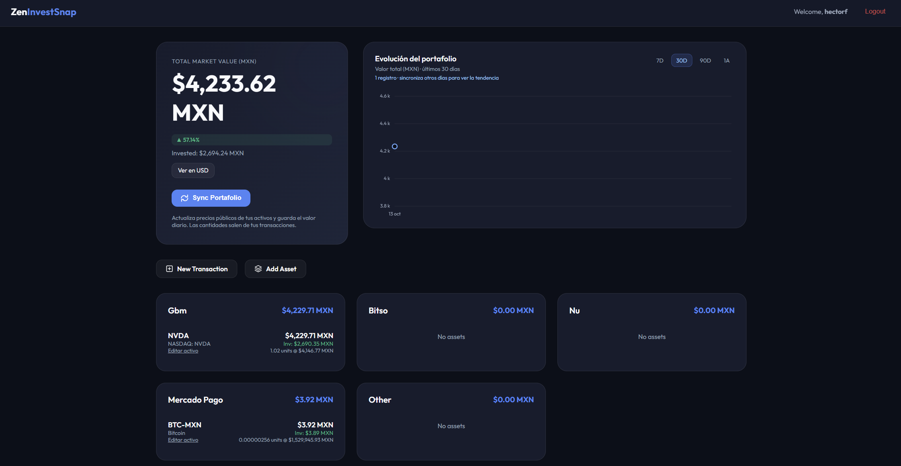

# 📈 ZenInvestSnap: Seguimiento de Inversiones Automatizado con Django



zen-invest-snap (directorio proyecto)
.env
README.md
requirements.txt

>

main (directorio app)
- Layouts (base.html, dashboard.html, login.html, register.html)
- Models (asset.py, daily_snapshot.py, portfolio_value.py, transaction.py)
- Views (dashboard.py, login.py, register.py)
- URLs (urls.py)
- Logic (calculations.py)
- run_daily_snapshot.py
zen_invest_snap (directorio app)
- providers.py
bitso (directorio app)
- provider.py
gbm (directorio app)
mercado_pago (directorio app)
nu (directorio app)

## 🚀 Instalación y Configuración

### 1. Preparación del Entorno (Local)
```bash
# Crear entorno virtual
python -m venv venv
# Activar (Windows)
venv\Scripts\activate
# Instalar dependencias
pip install -r requirements.txt
```

### 2. Configuración de Variables de Entorno
Crea un archivo `.env` en la raíz basado en `.env.example`:
```env
DEBUG=True
SECRET_KEY=tu_clave_secreta
```

### 3. Docker (Recomendado 🚀)
Si tienes Docker y Docker Compose instalados, puedes levantar el proyecto fácilmente:

1.  **Levantar el servicio:**
    ```bash
    docker-compose up -d --build
    ```
2.  **Primera inicialización (si quieres crear un superusuario):**
    ```bash
    docker-compose exec web python zen_invest_snap/manage.py createsuperuser
    ```
    La aplicación ejecuta `migrate` automáticamente al arrancar, así que no necesitas crear la base de datos manualmente antes del primer acceso.
3.  **Acceder:** Visita `http://localhost:8000` en tu navegador.

### 4. Base de Datos (Local)
Si prefieres correrlo localmente sin Docker:
```bash
cd zen_invest_snap
python manage.py migrate
python manage.py createsuperuser
python manage.py runserver
```

### Moneda y sincronización del portafolio
- Los tipos de activo son: **Stock** (acción individual, por ejemplo NVDA), **Cryptocurrency** (cripto, por ejemplo BTC), **Fiat Currency** (dinero en una moneda, por ejemplo MXN/USD), **ETF** (fondo cotizado que agrupa activos) y **Bond** (instrumento de deuda/renta fija). **Savings / Yield account** añade apartados de ahorro con rendimiento.
- Los precios de las transacciones se capturan en MXN. El dashboard muestra MXN por defecto y el botón **Ver en USD** convierte temporalmente los valores usando la última cotización USD/MXN de Yahoo Finance. Las cotizaciones de mercado pueden tener retraso y diferir de otras fuentes.
- Si no se puede consultar el tipo de cambio, el dashboard muestra un error y mantiene los montos en MXN.
- **Sync Portafolio** consulta precios públicos de acciones, ETF y cripto usando Yahoo Finance, convierte cotizaciones USD a MXN y guarda snapshots diarios y el total del portafolio. No requiere llaves API. Usa el símbolo bursátil real (por ejemplo, `NVDA`, no `NVIDIA`); los tickers mexicanos deben usar el sufijo `.MX`. Las criptomonedas se consultan en USD incluso cuando el ticker está escrito como `BTC-MXN`, y luego se convierten a MXN.
- Docker Compose inicia un servicio de snapshots que guarda el valor del portafolio diariamente a medianoche en la zona horaria configurada en Django (`TIME_ZONE`). También puede ejecutarse manualmente con `python manage.py run_daily_snapshot`.
- Las cantidades y saldos se calculan a partir de las compras, ventas, depósitos y retiros registrados para cada activo y plataforma. Registrar el mismo ticker en Bitso y Mercado Pago crea posiciones independientes; una venta en Bitso no cambia el saldo de Mercado Pago. Las cuentas privadas de esas plataformas no se consultan automáticamente. Si no se puede consultar el tipo de cambio, se conserva el último precio guardado en MXN cuando existe; los precios USD antiguos quedan pendientes hasta una sincronización exitosa.
- Precisión de datos: `Transaction.price` y `DailySnapshot.closing_price` guardan hasta 4 decimales; las cantidades guardan hasta 10; los totales diarios de `PortfolioValue` guardan 2. El dashboard también calcula el total actual desde posiciones y snapshots, y lo presenta redondeado a 2 decimales sin reducir la precisión de los cálculos ni modificar esos campos.
- El dashboard muestra las cantidades de cripto hasta con 10 decimales (sin ceros finales) para que saldos pequeños, como Bitcoin, sean legibles; otros activos muestran hasta 4 decimales.
- Los activos de tipo **Savings / Yield account** representan apartados manuales de Mercado Pago o Nu. Registra aportaciones/retiros como transacciones con precio unitario de 1 MXN; el saldo calcula interés simple diario sobre el principal neto, con la tasa anual indicada en cada apartado. Tasas sugeridas al crear: 10% para Mercado Pago y 6.5% para Nu; ajústalas a las condiciones vigentes. Los cambios de tasa aplican desde su fecha de edición y no recalculan el rendimiento anterior. Sincronizar guarda el valor diario para el gráfico.

## 🔮 Próximos Pasos (Hoja de Ruta)
1.  **Integraciones Pendientes:** Evaluar APIs oficiales para importar automáticamente saldos privados de los proveedores.
2.  **Alertas:** Sistema de notificaciones cuando un activo sube o baja de cierto porcentaje.

## 🤝 Contribución
¡Las contribuciones son bienvenidas! Sigue el flujo estándar de Pull Requests.

## 📄 Licencia
Este proyecto está bajo la Licencia MIT - mira el archivo [LICENSE](LICENSE) para detalles.
